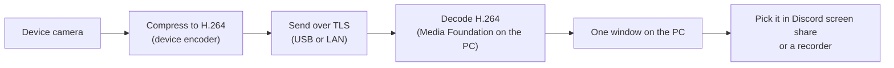
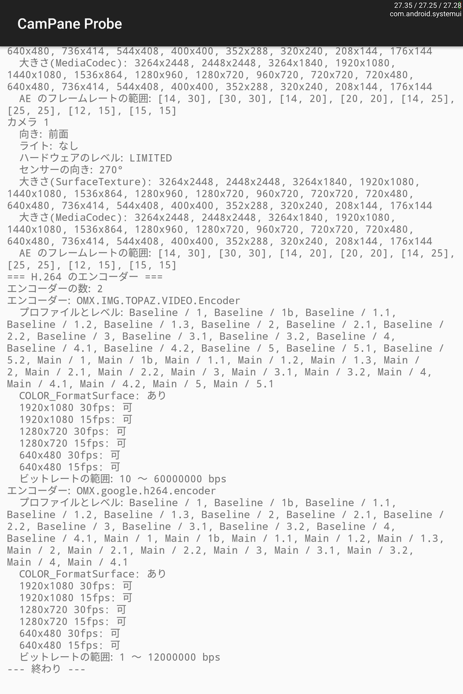

# CamPane

Software for showing the camera of an Android device in a single window on a Windows PC (work in progress).

English | [日本語](README.md)

> [!WARNING]
> **Work in progress. The only thing here today is a set of measurement tools (probes) used to settle the design.**
> The app itself does not exist yet. **You cannot show the device's camera live on the PC yet.**
> The probes only record 5 seconds on the device, save the compressed video to a file, and then decode that file on the PC to count frames or play it back in a loop in a window.

## Contents

- [What it is meant to become](#what-it-is-meant-to-become)
- [Current status](#current-status)
- [What the measurements showed](#what-the-measurements-showed)
- [Screenshot](#screenshot)
- [Getting started](#getting-started)
- [Using the probes](#using-the-probes)
- [Building from source](#building-from-source)
- [Safety and privacy](#safety-and-privacy)
- [Manual](#manual)
- [License](#license)

## What it is meant to become

A way to use an Android device on your desk as a camera, to show your hands (fingers on an instrument, a sketch on paper, a board game) in a call or a screen share.

The device compresses its camera video to H.264 and sends it to the PC over TLS. The PC side just shows it in an ordinary window; in Discord screen share or a recorder, you pick that window. It will not be a virtual camera (no driver). No audio.

The planned design (not working yet):



Because it handles a camera, the app is designed to keep to these rules:

- While the camera is running, the device always shows "Sending" and the name of the PC it sends to.
- It only streams while the app is on screen. Sending it to the background or turning the screen off stops the camera.
- Only a button on the device's screen can open the camera. The PC has no command to make the device open its camera.
- Closing the window on the PC stops the device's camera too.
- Video is never stored. No audio, and no microphone permission.
- Only paired devices get through. Nothing is sent to the internet.

## Current status

| Item | State |
|---|---|
| List the device's cameras and H.264 encoders (Android probe) | Done |
| Record 5 seconds on the device and save an H.264 file (Android probe) | Done (confirmed on a dtab d-01J) |
| List H.264 decoders on the PC and decode the file (PC probe `decoders` and `decode`) | Done |
| Compare how many pictures the decoder holds back, across 4 ways of feeding it (`decode`) | Done (v0.0.2) |
| Show the decoded pictures in a window on the PC (`show`) | Written. Not yet checked on real hardware |
| Whether Discord screen share and recorders can capture that window | Not yet |
| Comparison with existing products for the same purpose | Not yet |
| The app itself (connection, live video, device and PC screens) | Not started |

## What the measurements showed

Checked with the probes on a dtab d-01J (Android 7.0) and a Windows PC.

- **Connecting the camera directly to the encoder's input surface produced no frames at all.** The camera HAL would not accept the encoder's input surface as an output.
- **Putting SurfaceTexture and OpenGL ES in between (camera → SurfaceTexture → GL draws onto the encoder's input surface) worked at 1280x720, 30 fps.** 149 frames came out in 5 seconds.
- **The encoder produced Constrained Baseline even when Main was requested.** It did not reject Main when configured.
- **The Microsoft H.264 decoder on the PC held back about 35 pictures before outputting anything, for video whose SPS has no VUI (reordering information).** The dtab encoder's output has no VUI.
  - With low-latency mode (`CODECAPI_AVLowLatencyMode`), it held back 17.
  - Also writing `max_num_reorder_frames=0` into the SPS brought it down to 1.

## Screenshot

The Android probe running on a dtab d-01J (the camera and encoder lists).



## Getting started

Download these two files from the [v0.0.2 pre-release on Releases](https://github.com/takosasi-dev/cam-pane/releases/tag/v0.0.2).

| File | Contents |
|---|---|
| `CamPane-Probe-v0.0.2-win-x64.zip` | The PC probe (Windows 11 x64). It bundles the .NET 10 runtime, so you do not need to install .NET |
| `CamPane-Probe-v0.0.1-android.apk` | The Android probe (Android 7.0 or later). The same file as in v0.0.1. **A provisional build signed with a debug key** |

### PC

1. Extract the zip anywhere. It contains one folder, `CamPane-Probe-v0.0.2-win-x64`, with `CamPane.Probe.exe` inside.
2. Open PowerShell in that folder (no administrator rights needed).
3. Run `.\CamPane.Probe.exe` with no arguments to see the usage.

### Android

Install the APK in one of these ways.

- **On the device only**: copy the APK to the device and open it. If asked to allow apps from unknown sources, allow it (where this setting lives depends on the Android version and the device). You can turn it back off after installing.
- **With adb**: if the PC has `adb` from Android SDK Platform-Tools and USB debugging is on:

```powershell
adb install CamPane-Probe-v0.0.1-android.apk
```

The APK is signed with a provisional key. Once a build signed with the real key is released, you will need to uninstall it and install again.

## Using the probes

The flow is: record 5 seconds on the device → copy the file to the PC → count with `decode` → show it in a window with `show` → delete the video files.

### 1. Record 5 seconds on the device

Open the app "CamPane Probe". It lists the device, its cameras and its encoders. Tap **"5 秒圧縮して保存"** (encode 5 seconds and save) to record 5 seconds with the back camera (or the first camera if there is no back camera), compress it, and save it to a file. The first time, it asks for the camera permission.

- It uses the GL path (camera → SurfaceTexture → GL → encoder).
- If 1280x720 at 30 fps fails, it prints the reason and tries once more at 640x480.
- If the app goes to the background or the screen turns off while recording, it stops and closes the camera. The partial file is deleted.

You can also start it from adb (run it once from the button first and grant the camera permission):

```powershell
adb shell am start -n io.github.takosasidev.campane.probe/.MainActivity --es action encode         # via GL
adb shell am start -n io.github.takosasidev.campane.probe/.MainActivity --es action encode-direct  # direct (for comparison)
```

Every line on screen also goes to logcat (tag `CamPaneProbe`). On success the screen shows "保存したパス" (saved path). Files go into this folder, named `campane_probe_<datetime>.h264`:

```text
/storage/emulated/0/Android/data/io.github.takosasidev.campane.probe/files/
```

### 2. Copy the file to the PC

Use `adb pull` (copying it over USB file transfer has not been checked).

```powershell
# Example (use the file name from the "saved path" line on screen)
adb pull /storage/emulated/0/Android/data/io.github.takosasidev.campane.probe/files/campane_probe_20260101_120000.h264
```

### 3. The PC probe

| Subcommand | What it does |
|---|---|
| `decoders` | Lists the Media Foundation H.264 decoders |
| `decode <file>` | Decodes the file in 4 ways of feeding it and compares the frame count and how many pictures the decoder holds back. No window |
| `show <file>` | Decodes the file and loops it at about 30 fps in a window titled "CamPane Probe". Ends when you close the window or after 10 minutes |

It reads raw H.264 (Annex B) files up to 200 MB. Even on failure the exit code stays 0; the reason is on a line starting with `失敗:` (failed).

How to read the comparison at the end of `decode`:

| Row | How it feeds the decoder | What to look at |
|---|---|---|
| (a) | One NAL unit at a time, as is | Baseline |
| (b) | With low-latency mode (`CODECAPI_AVLowLatencyMode`) | Fewer pictures held back than (a)? |
| (c) | As (b), plus one whole picture per sample | Does the way of feeding change it? |
| (d) | As (c), plus `max_num_reorder_frames=0` written into the SPS | Down to 0–1 pictures? |

The "絵に直すと" (in pictures) value in the "遅れ" (lag) column is how many pictures the decoder held back. 0–1 means nothing is held back. Example output (the 5-second video from the dtab d-01J; the file name is made up and some lines are shortened):

```text
> .\CamPane.Probe.exe decode campane_probe_20260101_120000.h264
ファイル: campane_probe_20260101_120000.h264  152804 バイト
絵: 149 枚(スライスの first_mb_in_slice が 0 の所で区切った)
...
比べ(...):
  (a) 今のまま:         ... 遅れ 中央値 64・最大 70 NAL、絵に直すと 中央値 32・最大 35 枚(120 枚で) / 復号 149 枚 ...
  (b) 低遅延:           ... 遅れ 中央値 34・最大 34 NAL、絵に直すと 中央値 17・最大 17 枚(132 枚で) / 復号 149 枚 ...
  (c) 低遅延+1 枚ずつ:  ... 遅れ 中央値 17・最大 17 サンプル、絵に直すと 中央値 17・最大 17 枚(132 枚で) / 復号 149 枚 ...
  (d) (c)+SPS 書き足し: ... 遅れ 中央値 1・最大 1 サンプル、絵に直すと 中央値 1・最大 1 枚(148 枚で) / 復号 149 枚 ...
  デコーダーは (a)〜(d) とも同じ: Microsoft H264 Video Decoder MFT {62ce7e72-4c71-4d20-b15d-452831a87d9d}
```

`show` opens a window. It is there so you can pick that window in Discord screen share or a recorder and check that the video does not turn black (this has not been checked on the author's side yet).

```powershell
.\CamPane.Probe.exe show campane_probe_20260101_120000.h264   # example
```

### 4. Delete the video files

When you are done, delete the file on both the device and the PC (see [Safety and privacy](#safety-and-privacy)).

## Building from source

| Side | Requirements | Command | Output |
|---|---|---|---|
| PC | Windows 11 x64, .NET 10 SDK | `dotnet build pc\CamPane.sln -c Release` | `pc\src\CamPane.Probe\bin\Release\net10.0-windows\win-x64\CamPane.Probe.exe` |
| Android | JDK 17, Android SDK | `cd android; .\gradlew.bat assembleDebug` | `android\probe\build\outputs\apk\debug\probe-debug.apk` |

- A PC probe built from source does not bundle the runtime, so the PC that runs it needs .NET 10.
- For Android, put the Android SDK location in `android\local.properties` (this file is not committed).

```properties
# Example. Use your own SDK location
sdk.dir=C\:\\Android\\Sdk
```

## Safety and privacy

- **The video shows your room. When you are done, delete the file on both the device and the PC.**
  - Device: `adb shell rm <saved path>`, or uninstall the app, which removes its whole storage folder.
  - PC: delete the file you copied with `adb pull`.
- The probes do not use the network. The only permission the Android probe asks for is CAMERA; it has no INTERNET permission.
- The PC probe never writes decoded pictures to disk.
- `.gitignore` keeps video files (`*.h264` and others) out of the repository.

## Manual

A Japanese manual (PDF) will be attached to Releases as `CamPane-Probe-manual-ja.pdf`. It walks through the flow above with numbered steps and a troubleshooting table.

## License

MIT ([LICENSE](LICENSE)). Licenses of the libraries used and of the bundled runtime are in [THIRD-PARTY-NOTICES.md](THIRD-PARTY-NOTICES.md). Changes are recorded in [CHANGELOG.md](CHANGELOG.md).
