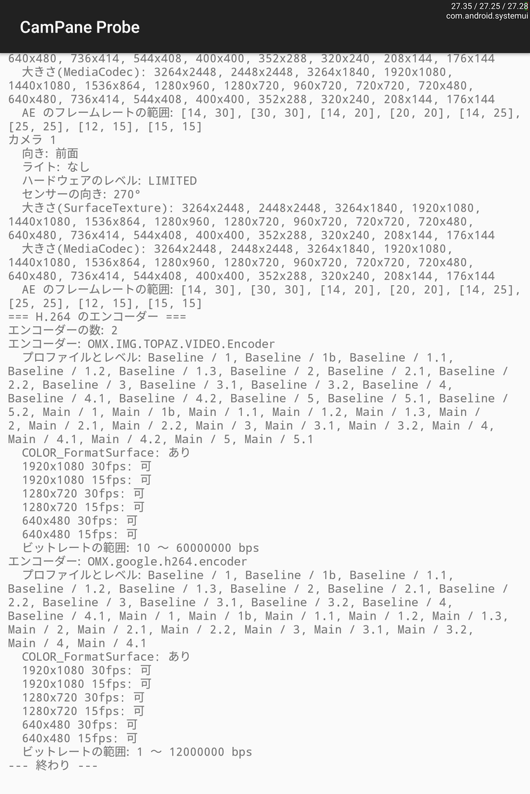

# CamPane

Android 端末のカメラの映像を、Windows PC の 1 枚のウィンドウに映すためのソフトです(開発中)。

[English](README.en.md) | 日本語

> [!WARNING]
> **開発中です。いまあるのは設計を決めるための測定用ツール(Probe)だけです。**
> アプリ本体は、まだありません。**端末のカメラの映像を PC に生で映すことは、まだできません。**
> Probe は、端末で 5 秒だけ撮って圧縮した映像をファイルに保存し、そのファイルを PC で復号して数えたり、ウィンドウで繰り返し再生したりするだけです。

## 目次

- [作ろうとしている物](#作ろうとしている物)
- [いまの状況](#いまの状況)
- [測定でわかったこと](#測定でわかったこと)
- [画面](#画面)
- [はじめ方](#はじめ方)
- [測定用ツールの使い方](#測定用ツールの使い方)
- [ソースからビルド](#ソースからビルド)
- [安全とプライバシー](#安全とプライバシー)
- [取扱説明書](#取扱説明書)
- [ライセンス](#ライセンス)

## 作ろうとしている物

通話や画面共有で、手元(楽器の指、紙に書いた図、ボードゲームの盤面など)を見せたいときに、机の上の Android 端末をカメラとして使うためのソフトです。

端末のカメラの映像を H.264 に圧縮し、TLS で PC へ送ります。PC 側は普通のウィンドウに映すだけです。Discord の画面共有や録画のソフトでは、そのウィンドウを選んで使います。仮想カメラ(ドライバ)にはしません。音は扱いません。

これから作る構成(まだ動きません):


カメラを扱うので、本体は次を守る設計にしています。

- カメラが動いている間、端末の画面に必ず「送信中」と送り先の PC の名前を出します。
- 映すのは、端末のアプリが画面に出ている間だけです。裏に回したり画面を消したりすると、カメラを止めます。
- カメラを開けるのは端末の画面のボタンだけです。PC 側から端末のカメラを開かせる指示はありません。
- PC 側のウィンドウを閉じると、端末のカメラも止まります。
- 映像を保存しません。音を扱わず、マイクの権限を求めません。
- 通信はペアリングした端末だけを通します。インターネットへは通信しません。

## いまの状況

| 項目 | 状態 |
|---|---|
| 端末のカメラと H.264 のエンコーダーの一覧を出す(Android の Probe) | 済み |
| 端末で 5 秒撮って H.264 のファイルに保存する(Android の Probe) | 済み(dtab d-01J で確認) |
| PC の H.264 のデコーダーの一覧と、ファイルの復号(PC の Probe の `decoders` と `decode`) | 済み |
| 絵が出るまでの溜め(遅れ)を 4 通りの入れ方で比べる(`decode`) | 済み(v0.0.2) |
| 復号した絵を PC のウィンドウに出す(`show`) | 作った。実機での確認はこれから |
| そのウィンドウを Discord の画面共有や録画のソフトで取り込めるか | これから |
| 同じ用途の既製品との比べ | これから |
| アプリ本体(接続、生の映像、端末と PC の画面) | 未着手 |

## 測定でわかったこと

dtab d-01J(Android 7.0)と Windows の PC で、Probe を使って確かめたことです。

- **カメラをエンコーダーの入力面に直接つなぐと、1 枚も出ませんでした。** カメラの HAL が、エンコーダーの入力面を出力先として受けませんでした。
- **SurfaceTexture と OpenGL ES を挟む(カメラ → SurfaceTexture → GL でエンコーダーの入力面に描く)と、1280x720・30 fps で圧縮できました。** 5 秒で 149 フレームが出ました。
- **エンコーダーは Main プロファイルを頼んでも、Constrained Baseline で出しました。** 設定の時点では Main を断りませんでした。
- **PC の Microsoft の H.264 デコーダーは、SPS に VUI(並べ替えの情報)が無い映像だと、約 35 枚溜めてから絵を出しました。** dtab のエンコーダーの映像には VUI がありません。
  - 低遅延の設定(`CODECAPI_AVLowLatencyMode`)にすると、溜めは 17 枚になりました。
  - さらに SPS に `max_num_reorder_frames=0` を書き足すと、溜めは 1 枚になりました。

## 画面

Android の Probe を dtab d-01J で動かした画面です(カメラとエンコーダーの一覧の部分)。



## はじめ方

[Releases の v0.0.2(プレリリース)](https://github.com/takosasi-dev/cam-pane/releases/tag/v0.0.2) から、次の 2 つをダウンロードします。

| ファイル | 中身 |
|---|---|
| `CamPane-Probe-v0.0.2-win-x64.zip` | PC の Probe(Windows 11 x64)。.NET 10 のランタイムを同梱しているので、.NET を入れなくても動きます |
| `CamPane-Probe-v0.0.1-android.apk` | Android の Probe(Android 7.0 以上)。v0.0.1 と同じ物です。**デバッグ用の鍵で署名した仮の物**です |

### PC

1. zip を好きな場所に展開します。中に `CamPane-Probe-v0.0.2-win-x64` のフォルダが 1 つあり、その中に `CamPane.Probe.exe` があります。
2. そのフォルダで PowerShell を開きます(管理者でなくてかまいません)。
3. `.\CamPane.Probe.exe` を引数なしで動かすと、使い方が出ます。

### Android

次のどちらかで APK を入れます。

- **端末だけで入れる**: APK を端末に写して開きます。「提供元不明のアプリ」を許可するよう求められたら、許可します(場所は Android の版と機種で違います)。入れ終えたら、許可を元に戻してかまいません。
- **adb で入れる**: PC に Android SDK Platform-Tools の `adb` があり、端末で USB デバッグを有効にしてある場合:

```powershell
adb install CamPane-Probe-v0.0.1-android.apk
```

APK は仮の鍵で署名しています。正式な鍵で署名した版が出たら、いったん消してから入れ直す必要があります。

## 測定用ツールの使い方

流れは「端末で 5 秒撮る → PC へ写す → `decode` で数える → `show` でウィンドウに映す → 映像のファイルを消す」です。

### 1. 端末で 5 秒撮る

アプリ「CamPane Probe」を開くと、端末とカメラとエンコーダーの一覧が出ます。画面の **「5 秒圧縮して保存」** を押すと、背面カメラ(無ければ最初のカメラ)で 5 秒撮り、圧縮してファイルに保存します。最初の 1 回は、カメラの権限を求めます。

- 経路は GL 経由です(カメラ → SurfaceTexture → GL → エンコーダー)。
- 1280x720・30 fps で駄目なら、理由を出して 640x480 で 1 回やり直します。
- 撮っている間にアプリを裏に回したり画面を消したりすると、中断してカメラを閉じます。途中のファイルは消します。

adb から動かすこともできます(先に画面のボタンで 1 回動かし、カメラの権限を許可しておきます)。

```powershell
adb shell am start -n io.github.takosasidev.campane.probe/.MainActivity --es action encode         # GL 経由
adb shell am start -n io.github.takosasidev.campane.probe/.MainActivity --es action encode-direct  # 直接(比べるための経路)
```

画面に出る行は、logcat(タグ `CamPaneProbe`)にも出ます。保存に成功すると、画面に「保存したパス」が出ます。保存先は次のフォルダで、ファイル名は `campane_probe_<日時>.h264` です。

```text
/storage/emulated/0/Android/data/io.github.takosasidev.campane.probe/files/
```

### 2. PC へ写す

`adb pull` で写します(USB のファイル転送で取り出せるかは、確かめていません)。

```powershell
# 例(ファイル名は画面の「保存したパス」に合わせる)
adb pull /storage/emulated/0/Android/data/io.github.takosasidev.campane.probe/files/campane_probe_20260101_120000.h264
```

### 3. PC の Probe

| サブコマンド | やること |
|---|---|
| `decoders` | Media Foundation の H.264 のデコーダーの一覧を出す |
| `decode <ファイル>` | ファイルを 4 通りの入れ方で復号し、フレームの数と、絵が出るまでの溜めを比べる。ウィンドウは出さない |
| `show <ファイル>` | ファイルを復号して、ウィンドウ「CamPane Probe」に 30 fps 相当で繰り返し映す。ウィンドウを閉じるか、10 分たつと終わる |

読めるファイルは、生の H.264(Annex B)で 200 MB までです。失敗しても終了コードは 0 のままで、`失敗:` で始まる行に理由が出ます。

`decode` の最後に出る「比べ」の読み方です。

| 行 | 入れ方 | 見る所 |
|---|---|---|
| (a) | そのまま 1 NAL ずつ入れる | 基準 |
| (b) | 低遅延の設定(`CODECAPI_AVLowLatencyMode`)にして入れる | (a) より溜めが減るか |
| (c) | (b) に加えて、1 枚の絵を 1 サンプルにまとめて入れる | 入れ方で溜めが変わるか |
| (d) | (c) に加えて、SPS に `max_num_reorder_frames=0` を書き足して入れる | 溜めが 0〜1 枚になるか |

「遅れ」の「絵に直すと」の値が、デコーダーが溜めた絵の枚数です。0〜1 枚なら溜めはありません。出力の例(dtab d-01J の 5 秒の映像。ファイル名は架空、行は一部を略した):

```text
> .\CamPane.Probe.exe decode campane_probe_20260101_120000.h264
ファイル: campane_probe_20260101_120000.h264  152804 バイト
絵: 149 枚(スライスの first_mb_in_slice が 0 の所で区切った)
...
比べ(...):
  (a) 今のまま:         ... 遅れ 中央値 64・最大 70 NAL、絵に直すと 中央値 32・最大 35 枚(120 枚で) / 復号 149 枚 ...
  (b) 低遅延:           ... 遅れ 中央値 34・最大 34 NAL、絵に直すと 中央値 17・最大 17 枚(132 枚で) / 復号 149 枚 ...
  (c) 低遅延+1 枚ずつ:  ... 遅れ 中央値 17・最大 17 サンプル、絵に直すと 中央値 17・最大 17 枚(132 枚で) / 復号 149 枚 ...
  (d) (c)+SPS 書き足し: ... 遅れ 中央値 1・最大 1 サンプル、絵に直すと 中央値 1・最大 1 枚(148 枚で) / 復号 149 枚 ...
  デコーダーは (a)〜(d) とも同じ: Microsoft H264 Video Decoder MFT {62ce7e72-4c71-4d20-b15d-452831a87d9d}
```

`show` はウィンドウを出します。Discord の画面共有や録画のソフトでこのウィンドウを選び、映像が黒くならずに見えるかを確かめるための物です(作者の環境での確認はこれからです)。

```powershell
.\CamPane.Probe.exe show campane_probe_20260101_120000.h264   # 例
```

### 4. 映像のファイルを消す

確かめ終えたら、端末と PC の両方からファイルを消します([安全とプライバシー](#安全とプライバシー))。

## ソースからビルド

| 側 | 要る物 | 命令 | 出力 |
|---|---|---|---|
| PC | Windows 11 x64、.NET 10 SDK | `dotnet build pc\CamPane.sln -c Release` | `pc\src\CamPane.Probe\bin\Release\net10.0-windows\win-x64\CamPane.Probe.exe` |
| Android | JDK 17、Android SDK | `cd android; .\gradlew.bat assembleDebug` | `android\probe\build\outputs\apk\debug\probe-debug.apk` |

- ソースからビルドした PC の Probe はランタイムを同梱しないので、動かす PC にも .NET 10 が要ります。
- Android は、`android\local.properties` に Android SDK の場所を書いておきます(このファイルはリポジトリに入れません)。

```properties
# 例。自分の SDK の場所に直す
sdk.dir=C\:\\Android\\Sdk
```

## 安全とプライバシー

- **映像には部屋が映ります。確かめた後は、端末と PC の両方からファイルを消してください。**
  - 端末: `adb shell rm <保存したパス>`。または、アプリを消すと保存先のフォルダごと消えます。
  - PC: `adb pull` で写したファイルを消します。
- Probe は通信しません。Android の Probe が求める権限は CAMERA だけで、INTERNET の権限はありません。
- PC の Probe は、復号した絵をファイルに保存しません。
- `.gitignore` で、映像のファイル(`*.h264` など)がリポジトリに入らないようにしてあります。

## 取扱説明書

日本語の取扱説明書(PDF)を、Releases に `CamPane-Probe-manual-ja.pdf` として置きます。上の流れを、番号つきの手順と困ったときの表つきで説明しています。

## ライセンス

MIT([LICENSE](LICENSE))。使っているライブラリと同梱するランタイムのライセンスは [THIRD-PARTY-NOTICES.md](THIRD-PARTY-NOTICES.md) にあります。変更の記録は [CHANGELOG.md](CHANGELOG.md) にあります。
